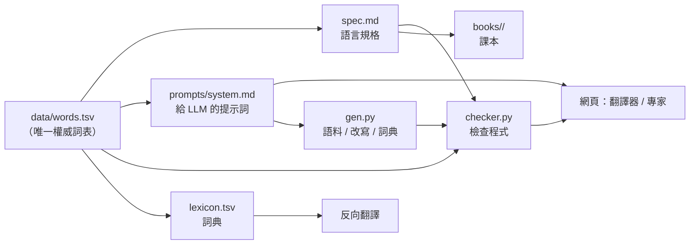

# learn-talk

* 線上版
  * 靜態 -- https://learn-talk.github.io/learn-talk/core/staticweb/index.html
  * cloudflare -- https://learn-talk.ccckmit.workers.dev

**用很少的字詞學會說話。** 五個受限語言（Mini-Chinese、Mini-English、Mini-French、Mini-Japanese、Mini-Korean），
讓外國人學會其中一種語言的日常會話、讀懂受限語言的文章、把一般文章改寫成受限語言。

| 語言 | 單位數 | 核心層 | 擴充層 | 詞典 | 課本 |
|---|---:|---:|---:|---|
| [Mini-Chinese](langs/mini-chinese/) 簡易中文 | 449 字 | 449 | 0 | 1,248 | [40 章](books/chinese/) |
| [Mini-English](langs/mini-english/) 簡易英文 | 1,256 詞 | 600 | 656 | 1,748 | [40 章](books/english/) |
| [Mini-French](langs/mini-french/) 簡易法文 | 1,155 詞 | 752 | 403 | 532 | [40 章](books/french/) |
| [Mini-Japanese](langs/mini-japanese/) 簡易日文 | 985 詞 | 425 | 560 | 337 | [40 章](books/japanese/) |
| [Mini-Korean](langs/mini-korean/) 簡易韓文 | 1,124 詞 | 659 | 465 | 246 | [40 章](books/korean/) |

每個語言都是**該語言的子集**：寫出來的每一句都是母語者看得懂、說起來自然的話，只是用字受到限制。

---

## 這個專案在做什麼

```
core/          共用引擎（不含任何語言知識）
  spec.py        規格載入：詞表、類頭、描述模板、替代表、語法規則
  tokenizer.py   切分器：中文逐字、日文最長匹配、韓文語節、法英按詞
  morph.py       形態：英法屈折、日文活用、韓文活用
  french.py      法文動詞變化（現在式）
  japanese.py    日文音便與活用
  korean.py      韓文助詞與活用
  checker.py     通用檢查器（表外詞、外來語、禁用詞、描述合法性）
  lexicon.py     詞典與反向翻譯
  build.py       產生 spec.md 與 prompts/system.md
  report.py      自我檢查報告
  gen.py         LLM 生成管線（語料、改寫、詞典）
  coverage.py    覆蓋率測試
  llm.py         NVIDIA（GLM 5.3 Flash）／MiniMax（M3.1 Flash）統一介面
  web/           網頁：翻譯器、檢查器、詞表、LLM 專家、發音（TTS）

langs/         五個語言的規格與資料
  mini-chinese/   data/words.tsv（權威詞表）、lexicon.tsv、spec.md、prompts/、report.md
  mini-english/   …
  mini-french/    …
  mini-japanese/  …
  mini-korean/    …

books/         五本課本（繁體中文讀者，每本 40 章）
tools/         產生資料的腳本（遷移、詞表生成、校訂、課本、報告）
tests/         引擎測試
doc/           計畫與設計文件
```



---

## 三層表達法（所有語言共用）

| 層 | 什麼時候用 | 例子 |
|---|---|---|
| 本詞 | 詞表內的詞 | 直接用 |
| 描述 | 表外的通用概念 | 描述 ＋ 類頭（看病的地方／a place where…） |
| 外來語 | 說不出「是哪一個」（人名、物種、品牌） | 原文 ＋ 第一次出現加括號說明 |

「先定義、後沿用」：第一次用描述或外來語時說明，之後直接用。

---

## 快速開始

需要 Python 3.13：

```bash
cd learn-talk
uv venv .venv --python 3.13
source .venv/bin/activate
uv pip install openai edge-tts      # openai：LLM；edge-tts：語音（可選）
```

### 檢查一段文字

```bash
python -m core.cli check zh "我家有一個 dog（會看家的小東西）。"
python -m core.cli check fr "J'ai mangé une pomme."
python -m core.cli check ja "私は学生です。"
python -m core.cli check ko "어제 친구를 만났어요."
```

### 開網頁（翻譯器／檢查器／詞表／LLM 專家／唸出來）

```bash
python core/web/server.py
# → http://localhost:8770/
```

### 三種網頁版本

| 版本 | 目錄 | 特色 |
|---|---|---|
| 有後端 | `core/web/` | 本機伺服器：金鑰在伺服器、完整檢查器、edge-tts 語音 |
| 免後端 | `core/staticweb/` | 純靜態：使用者自己填 key，瀏覽器直接呼叫 LLM（串流） |
| Cloudflare | `core/cloudflare/` | 同上，但詞表與提示詞放在 R2／KV，網站本體只有幾 KB（見該目錄 README） |

資料與前端可由 `tools/build_cloudflare.py` 從 `core/web/` 與 `core/staticweb/` 產生。

語音（全部免費、不用 key）：

- 瀏覽器語音（已強化：挑系統優質語音、逐句朗讀、語速微調）
- `core/web` 版另有 edge-tts（Azure Neural 音色）
- 靜態／Cloudflare 版可填「edge-tts 服務網址」借用自架的 edge-tts（`core/web` 的 `/api/tts` 已有 CORS），
  連不上時自動退回瀏覽器語音

### 自我檢查（詞表、文件、詞典是否一致）

```bash
python -m core.cli report zh
python tests/test_core.py
```

### 用 LLM 產生資料

```bash
export NVIDIA_API_KEY=...           # 或 MINIMAX_API_KEY=...

# 產生語料（給小語言模型訓練用）
python -m core.gen corpus --lang zh --topics topics.txt --out corpus/

# 改寫測試（會自我修正：把檢查器的錯誤回饋給模型）
python -m core.gen rewrite --lang zh --file articles.txt

# 產生詞典候選
python -m core.gen lexicon --lang zh --words common_words.txt
```

---

## 設計原則（五個語言共用）

1. **看「表達力」選詞，不看詞頻**：收「用其他詞描述不出來、加進來又能組出很多詞」的詞。
2. **一個概念一個詞**：去掉同義詞（只留 grand，不留 gros／immense）。
3. **數字用阿拉伯數字**：1、2、3、100、20%。
4. **語法盡量少、盡量規則**：每個語言 20–35 條編號規則；困難結構用固定替代說法。
5. **一切用程式檢查**：詞表是唯一權威來源，spec.md、提示詞、詞典、網頁都從它產生或被它檢查。

各語言的取捨（法文的性數、日文不用て形、韓文只用해요體…）見各自的 [report.md](langs/)。

---

## 授權

[MIT License](LICENSE)
